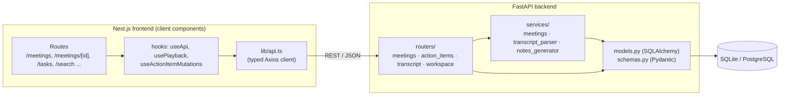
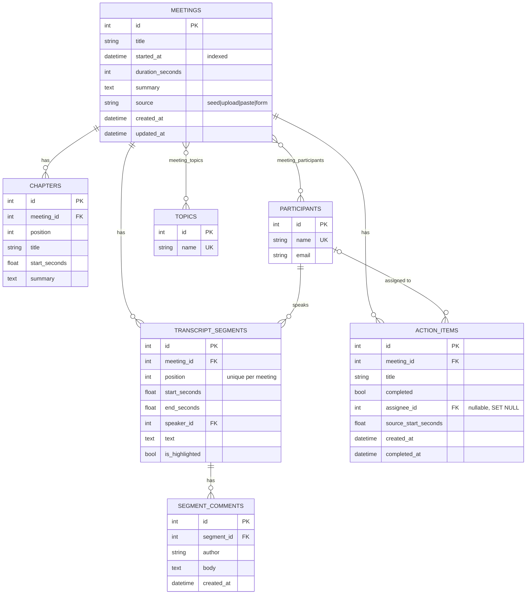

# MeetScribe — Fireflies.ai Clone

MeetScribe is a full-stack clone of the [Fireflies.ai](https://fireflies.ai) meeting-assistant web app. It recreates the
Fireflies post-meeting workflow: a meeting library, an interactive transcript synced to a media player, AI notes
(summary, keywords, outline, action items), search across every transcript, and full CRUD for meetings and their
contents.

| | |
|---|---|
| **Live app** | https://meetscribe-black.vercel.app/ |
| **API** | https://meetscribe-api.vercel.app/ — interactive docs at [`/docs`](https://meetscribe-api.vercel.app/docs) |
| **Repository** | https://github.com/snehakri12/meetscribe |

---

## Features

### Core (assignment requirements)

| Requirement | Where |
|---|---|
| Meeting library with title, date, duration, participants | `/meetings` — grouped by day like Fireflies, avatar stacks, keyword chips |
| Search & filter by title, date, participant (and transcript text) | Server-side filters: free text, participant, keyword, date range, *All / My meetings* tabs |
| Sort by recency | Newest / oldest toggle |
| Navbar with profile / settings | Top bar: global search, Capture, Upload, theme toggle, settings, profile menu |
| Interactive transcript with speaker labels & timestamps | `/meetings/[id]` right panel — colour-coded speakers, avatars, timestamps |
| Media player with seek bar | Sticky bottom player: play/pause, ±15 s, speed (1–2×), seek bar with speaker timeline |
| Click a line to seek **and vice versa** | Clicking a line/timestamp seeks; while playing the active line is highlighted and auto-scrolled ("Follow along") |
| Search within transcript with highlights | Highlighted matches, `n / total` counter, next/previous (Enter / Shift+Enter) |
| AI summary, action items, outline/chapters | Left panel: Overview, Keywords, Outline (clickable timestamps), Action items grouped by owner |
| Create a meeting (upload / paste / form) | *New meeting* modal and `/uploads`: upload `.txt`/`.vtt`/`.json`, paste a transcript, or notes-only form |
| Edit metadata, delete meeting | Edit modal (title, date, participants, keywords); delete with confirmation dialog |
| Add / edit / complete action items | Inline add, edit (title + assignee), complete, delete — on the meeting page, Home and `/tasks` |
| Persistence | Everything is stored in the database through the REST API |
| Fireflies experience: forms, modals, toasts, settings placeholders | Modals, confirm dialogs, toast notifications, `/settings`, coming-soon pages |

### Bonus features implemented

- **Highlights (soundbites) & comments** on transcript lines.
- **Export** a meeting as Markdown or plain text.
- **Global search** across all transcripts (`/search`) — results jump to the exact moment (`/meetings/1?t=94`).
- **Tags / keywords** with filtering (click a keyword chip anywhere to filter the library).
- **Dark mode** (light / dark / system, remembered per device).
- Speaker filter with talk-time percentages, keyboard shortcuts (Space, ←/→), responsive mobile layout.

### Placeholders ("Coming soon")

Live meeting bot (*Capture*), speech-to-text for audio/video uploads, integrations (Zoom, Meet, Teams, Calendar, Slack,
Salesforce), team sharing & roles, analytics, LLM "Ask AI" chat, notification settings, real authentication.

---

## Tech stack

| Layer | Technology |
|---|---|
| Frontend | Next.js 16 (App Router) · React 19 · TypeScript · Tailwind CSS v4 · Axios |
| Backend | Python 3.12 · FastAPI · SQLAlchemy 2 · Pydantic v2 · Uvicorn |
| Database | SQLite (default, local) · PostgreSQL via `DATABASE_URL` (Neon in production) |
| Testing | pytest + FastAPI TestClient (27 tests) · ESLint · `tsc` |
| Hosting | Vercel (frontend and backend), Neon (Postgres) |

---

## Project structure

```text
.
├── backend/
│   ├── main.py                 # FastAPI app, CORS, router registration
│   ├── database.py             # Engine/session, SQLite FK pragma, get_db dependency
│   ├── db_init.py              # Create tables, migrate legacy schema, seed when empty
│   ├── models.py               # SQLAlchemy models (schema below)
│   ├── schemas.py              # Pydantic request/response models + validation
│   ├── routers/
│   │   ├── meetings.py         # /meetings CRUD, transcript replace, notes generation
│   │   ├── action_items.py     # /action-items and /meetings/{id}/action-items
│   │   ├── transcript.py       # /segments highlights, /comments
│   │   └── workspace.py        # /participants, /topics, /stats, /search
│   ├── services/
│   │   ├── meetings.py         # Business logic (create, replace transcript, upserts)
│   │   ├── transcript_parser.py# .txt / .vtt / .json transcript parsing
│   │   └── notes_generator.py  # Heuristic ("mock AI") summary, keywords, chapters, action items
│   ├── seed.py / seed_data.py  # Six demo meetings with full transcripts
│   ├── tests/                  # pytest suite
│   └── vercel.json
└── frontend/
    ├── app/                    # Routes: /, /meetings, /meetings/[id], /tasks, /uploads,
    │                           #         /search, /settings, /integrations, /team, /analytics
    ├── components/
    │   ├── layout/             # AppShell, Sidebar, Topbar, CaptureModal
    │   ├── meetings/           # Library, filters, row, create form, edit modal, upload page
    │   ├── meeting-detail/     # Header, NotesPanel, TranscriptPanel, TranscriptLine, MediaPlayer, EditTranscriptModal
    │   ├── action-items/       # ActionItemRow, AddActionItemForm, ActionItemsBoard
    │   ├── home/ search/ settings/
    │   ├── providers/          # ThemeProvider, ToastProvider
    │   └── ui/                 # Icon, Avatar, Modal, ConfirmDialog, States, ComingSoon
    ├── hooks/                  # useApi, usePlayback, useActionItemMutations, useDebouncedValue
    └── lib/                    # api client, types, formatting, export, constants
```

---

## Setup

### Prerequisites

- Node.js 20+ and npm
- Python 3.10+ (developed on 3.12)

### 1. Backend

```bash
cd backend
python -m venv .venv
# Windows: .\.venv\Scripts\Activate.ps1      macOS/Linux: source .venv/bin/activate
pip install -r requirements.txt
cp .env.example .env            # optional — defaults to SQLite
uvicorn main:app --reload
```

- API: http://127.0.0.1:8000 · Swagger docs: http://127.0.0.1:8000/docs
- On startup the tables are created and, if the database has no meetings, the **six demo meetings are seeded
  automatically** (disable with `SEED_ON_STARTUP=false`).
- Manual seeding: `python seed.py` (adds missing demo meetings) or `python seed.py --reset` (drops and recreates the
  app tables, then seeds).

| Variable | Default | Purpose |
|---|---|---|
| `DATABASE_URL` | SQLite file `backend/fireflies.db` | SQLite or Postgres connection URL |
| `CORS_ORIGINS` | localhost:3000 + production URL | Comma-separated allowed frontend origins |
| `SEED_ON_STARTUP` | `true` | Seed demo data when the database is empty |

### 2. Frontend

```bash
cd frontend
npm install
cp .env.example .env.local      # NEXT_PUBLIC_API_URL=http://127.0.0.1:8000
npm run dev
```

Open http://localhost:3000. Keep both servers running.

### 3. Tests & checks

```bash
cd backend  && pip install -r requirements-dev.txt && python -m pytest
cd frontend && npm run lint && npx tsc --noEmit && npm run build
```

---

## Architecture



- **Frontend.** The App Router provides the page structure. Interactive pages are client components that fetch through
  a typed API client. `useApi` handles loading and error state and optimistic local updates (`mutate`). The meeting
  page shares one playback clock (`usePlayback`) between the player, the transcript (active line, follow-along), the
  outline and the action-item timestamps. Transcript lines are memoised, so playback ticks re-render only the line
  that becomes active. Colours are CSS variables, which makes dark mode a token swap.
- **Backend.** Routers handle HTTP concerns only. Business logic lives in `services/`. Pydantic schemas validate input:
  they reject blank titles, trim and de-duplicate participant names, and parse datetimes. Each response model is
  shaped for its screen: the list endpoint returns lightweight items with action-item counts, and the detail endpoint
  returns the full meeting with nested segments, chapters and action items. It is loaded with `selectinload`, which
  avoids N+1 queries.
- **Transcripts.** Uploaded or pasted text is parsed by `transcript_parser` into timed, speaker-labelled segments. Every
  speaker becomes a `Participant`. Missing timestamps are estimated from the speaking rate (about 2.5 words/s).
- **AI notes.** Real LLM calls are out of scope. `notes_generator` derives notes deterministically from the transcript:
  - keywords from word and phrase frequency
  - chapters by splitting the transcript into blocks
  - action items from commitment phrases ("I'll…", "we need to…", "can you…"), with the assignee inferred from the
    speaker
  - an overview that combines these

  Seeded meetings have hand-written notes. The function boundary is where an LLM call would plug in.

---

## Database schema



Design notes:

- **Normalised relations instead of JSON blobs.** Participants and topics are shared entities joined through
  association tables (composite primary keys). That makes "meetings with Laura" and "meetings tagged Pricing" simple
  indexed joins, and a person or tag is stored once.
- **Transcript segments are rows.** Each segment has an ordered `position`, start and end times, and a speaker foreign
  key. This enables full-text search across meetings, speaker filters, talk-time stats, per-line highlights and
  comments, and click-to-seek.
- **Action items link back to the conversation** through `source_start_seconds` and have an optional assignee. Deleting
  a participant sets `assignee_id` to NULL instead of deleting the task.
- **Integrity.** Child rows use `ON DELETE CASCADE`, mirrored by ORM `delete-orphan` cascades. SQLite enforces foreign
  keys via `PRAGMA foreign_keys=ON` on every connection. Indexes cover every foreign key, `meetings.started_at` (sorting
  and date filters) and `(meeting_id, completed)` for action-item counts.
- `started_at` stores the meeting's wall-clock time. Audit timestamps (`created_at`, `completed_at`) are UTC.

---

## API overview

All endpoints return JSON. Full request/response schemas are in Swagger at `/docs`. Validation errors return
`422`, and missing resources return `404`.

| Method | Endpoint | Description |
|---|---|---|
| GET | `/health` | Health check |
| GET | `/meetings` | List meetings. Query: `q` (title/summary/participant/keyword/transcript), `participant`, `topic`, `date_from`, `date_to`, `mine`, `sort=newest\|oldest` |
| POST | `/meetings` | Create a meeting. Body: `title`, `started_at?`, `participants[]`, `summary?`, `topics?`, `transcript_text`, `transcript_format=auto\|txt\|vtt\|json`, `source`, `generate_notes` |
| GET | `/meetings/{id}` | Meeting with participants, topics, chapters, segments (+comments) and action items |
| PATCH | `/meetings/{id}` | Update `title`, `started_at`, `participants[]`, `topics[]`, `summary` |
| DELETE | `/meetings/{id}` | Delete a meeting and everything that belongs to it (`204`) |
| PUT | `/meetings/{id}/transcript` | Replace the transcript; optional `regenerate_notes` |
| POST | `/meetings/{id}/generate-notes` | Regenerate summary, keywords and outline, and add newly detected action items |
| GET | `/meetings/{id}/action-items` | Action items of a meeting |
| POST | `/meetings/{id}/action-items` | Add an action item (`title`, `assignee_name?`, `source_start_seconds?`) |
| GET | `/action-items` | All action items with meeting titles. Query: `status=all\|open\|completed` |
| PATCH | `/action-items/{id}` | Update `title`, `completed`, `assignee_name` (empty string unassigns) |
| DELETE | `/action-items/{id}` | Delete an action item |
| PATCH | `/segments/{id}` | Highlight / un-highlight a transcript line (`is_highlighted`) |
| POST | `/segments/{id}/comments` | Comment on a transcript line |
| DELETE | `/comments/{id}` | Delete a comment |
| GET | `/search?q=` | Global search across all transcript lines (text or speaker) |
| GET | `/participants` · `/topics` | Filter options (only those used by at least one meeting) |
| GET | `/stats` | Workspace totals for the home dashboard |

Supported transcript formats for upload/paste:

```text
TXT    [00:12] Speaker: text   ·   00:12 Speaker: text   ·   Speaker (00:12): text   ·   Speaker: text
VTT    WEBVTT cues; speaker from <v Name>…</v> or "Name: text"
JSON   [{"speaker": "...", "text": "...", "start": 12.5 | "00:12", "end": ...}]  or  {"segments": [...]}
```

---

## Assumptions & limitations

- **Single default user.** Authentication is out of scope. The app runs as "Sneha"
  (`CURRENT_USER` in `frontend/lib/constants.ts` and `backend/services/meetings.py`), which drives *My meetings*,
  *Assigned to me* and comment authorship.
- **No real audio.** The player is a simulated playback clock over the meeting's duration. Seeking, speed, the
  active-line sync and follow-along all behave as they would with a recording. Audio/video upload and speech-to-text
  are placeholders.
- **Mock AI.** Notes for new transcripts are generated heuristically, not by an LLM. Seeded meetings have
  hand-written notes. "Ask AI" is a placeholder.
- **Database.** SQLite is the default, as the assignment specifies. Production uses Neon Postgres through the same
  SQLAlchemy models, because Vercel's serverless filesystem is temporary and a SQLite file would not persist there.
- **Legacy schema migration.** The first version of this project stored JSON strings in `meetings`/`tasks`. On startup
  `db_init.py` detects that schema and **renames** those tables to `legacy_meetings`/`legacy_tasks`, so nothing is
  dropped. It then creates the new schema and seeds it.
- Seed meeting dates are relative to the day the database is seeded, so the library always shows recent meetings.
- MeetScribe is an educational clone. It is not affiliated with Fireflies.ai and doesn't use its brand assets.

## Deployment (Vercel)

- **Backend project:** root directory `backend/` (uses `backend/vercel.json`). Environment variables: `DATABASE_URL`
  (Neon connection string) and `CORS_ORIGINS` (include the frontend URL).
- **Frontend project:** root directory `frontend/`. Environment variable: `NEXT_PUBLIC_API_URL` (the backend URL).
